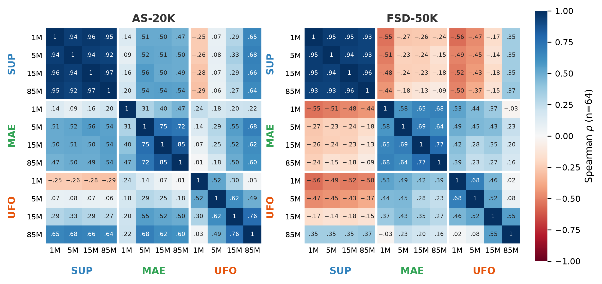
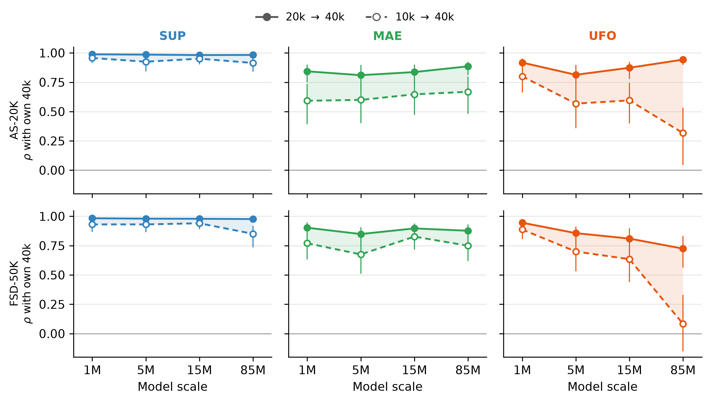
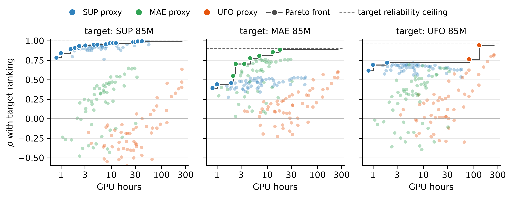
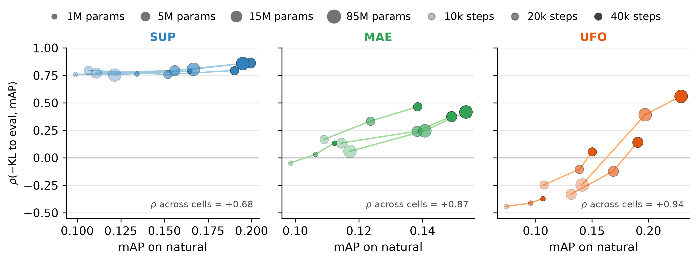
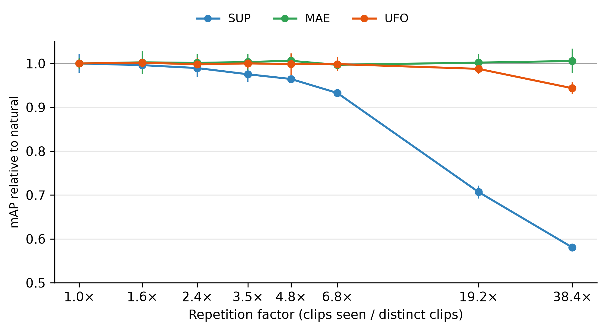

# Data Mixture Optimization for Audio Representation Learning

**Quinn Lue**
Department of Computer Science, Montana State University, Bozeman, MT, USA
luequinn@gmail.com

**Repository contents:** [`writeup.pdf`](writeup.pdf) (paper), [`plots/`](plots/) (figures used below), and [`data/`](data/) ([`readouts.csv`](data/readouts.csv), every LoRA and probe readout; columns in [`data/README.md`](data/README.md)).

## Abstract

Data mixture optimization is an important step for training robust foundation models. RegMix has shown that the data mixture quality surface can be well approximated by a swarm of small proxy models. While RegMix style applications are well studied in LLM pretraining, there is very little research showing their viability in audio foundation model pretraining. In this paper, we pretrain with utterance-frame objective, masked autoencoder, and supervised objectives across different scales (1M to 85M parameters) and budgets (10k to 40k optimizer steps). We optimize data mixture on 20 k-means generated AudioSet-2m clusters. On these 20 clusters, we sample 64 data mixtures and pretrain a model with each objective and scale on every mixture and evaluate with AS-20k and FSD-50k tagging. We find a strong negative result: small self-supervised models prefer genuinely different data mixtures from large ones. While supervised models rank mixtures much more consistently across all axes, we find that we can approximate supervised rankings with cheap heuristics — ranking mixtures by their KL divergence to the evaluation set's cluster distribution correlates with SUP-85M rankings at $\rho=0.86$.

## 1. Introduction

The mixture of pretraining corpus has become increasingly important for training robust foundation models. Recently, proxy based techniques have become increasingly popular ([Xie et al., 2023](#references); [Liu et al., 2025](#references); [Ye et al., 2025](#references)). To compare two pretraining mixtures, train a small "proxy" model on a shorter horizon and compare evaluation results. The hope is that the proxy models rank mixtures similarly to the full-scale model training so we can cheaply choose a pretraining mixture. This hope has been extensively tested and proved fruitful in the context of LLM pretraining ([Liu et al., 2025](#references); [Magnusson et al., 2025](#references)), but is largely unstudied in the broader context of self-supervised learning outside of image–text data curation ([Gadre et al., 2023](#references)).

For this assumption to hold, three properties must hold simultaneously for the same proxy training recipe. First, the proxy rankings must prefer the same data mixtures as full-scale training. Second, proxy results must not be so noisy that the rankings they yield are no longer useful. We need to be sure that the rankings are internally consistent across seed variance. And third, the proxy swarm must require meaningfully less compute than full pretraining — the whole point of a "proxy" is a cheap approximation.

We study these in audio representation learning. We cluster AudioSet ([Gemmeke et al., 2017](#references)) (AS) into 20 groups and pretrain a swarm of size 64, spanning different pretraining objectives, readout depths, readout methods, model scales, and evaluation sets. Unless otherwise stated, correlation and $\rho$ refer to Spearman's rank correlation ([Spearman, 1904](#references)). Our goal with this paper is not to deliver a new mixture that is superior to the natural AS distribution, but rather to analyze the viability of proxies as a tool for mixture optimization. Our findings:

- **SSL rankings don't transfer well, supervised ones do.** No UFO proxy recipe can reliably rank mixtures cheaply enough to be useful, even when disattenuated — cheap recipes have genuinely different mixture preferences. MAE proxies are slightly more reliable than UFO's. MAE-15M → MAE-85M correlate at $\rho=0.85$, although smaller recipes only show moderate or weak correlations. SUP transfers across every scale at a correlation coefficient of $\rho \ge 0.92$.
- **Supervised rankings reflect trivial baselines.** We found that supervised pretraining has a very strong preference for mixtures that match the evaluation distribution and are maximally diverse. Simply ranking mixtures by preferring mixtures with low KL divergence to the evaluation set yields a $\rho = 0.86$ for SUP-85M at 40k steps. This metric is very cheap to compute and requires no training. In contrast, SSL methods correlate with these much weaker. However, stronger recipes, such as UFO-85M, prefer mixtures that have high effective sample size and are well aligned with the evaluation set.
- **Rankings depend on readout method for SSL.** A frozen probe and LoRA fine-tuning agree at $\rho\approx0.99$ for SUP, but only $\rho\in[0.50,\ 0.86]$ for UFO and MAE pretraining.

## 2. Related work

**Mixture optimization via small-scale proxies.** DoReMi ([Xie et al., 2023](#references)) found domain weights using a 280m parameter model and used those weights to pretrain an 8b parameter model. RegMix ([Liu et al., 2025](#references)) fits a regression model to map data mixtures to proxy performance, yielding a high ranking correlation that transfers to larger models. Olmix ([Chen et al., 2026](#references)) does a thorough analysis on applying RegMix and suggests a log-linear model fit on at least $3(m+1)$ mixtures where $m$ is the number of clusters or domains you have. NVIDIA's CLIMB ([Diao et al., 2025](#references)) uses RegMix style mixture optimization within the context of LLM continual pretraining and evaluates on full inference rollouts. Aioli ([Chen et al., 2024](#references)) unifies these methods under a single optimization framework.

**General audio model pretraining.** A significant portion of general audio pretraining is done through some form of masked audio modelling. The majority of this is trained on epochs of AudioSet-2m with no additional data curation steps taken ([Huang et al., 2022](#references); [Chen et al., 2023](#references); [Chen et al., 2024](#references); [Dinkel et al., 2024](#references)). Pretraining and evaluation are known to have high seed variance ([Sellam et al., 2022](#references); [Madaan et al., 2024](#references)), which sets a direct upper bound for rank and magnitude correlations.

## 3. Experimental Setup

**Data, clusters, and the swarm.** The pretraining pool consists of $1.9$m AudioSet clips. We use the balanced split of AudioSet and FreeSound Dataset-50k ([Fonseca et al., 2022](#references)) for evaluation. We embed these with Dasheng-0.6B ([Dinkel et al., 2024](#references)) and cluster into 20 groups via *k*-means. A mixture $p$ is a 20 dimensional vector, where `natural` describes the natural distribution of data and yields a histogram showing the number of examples per cluster.

The main swarm consists of 64 mixtures sampled from a Dirichlet distribution, following [Liu et al. (2025)](#references), that span 0.83 to 1.91 nats from `natural`. Additionally, to isolate the effect of effective-sample size of pretraining, we generate i.i.d. random subsets of `natural` spanning 50k to 1.91M distinct clips. We treat the base scale, 40k step, LoRA, AS-20k readout, utterance-frame objective ([Chen et al., 2024](#references)) recipe as our primary target for experiments.

**Objectives.** We test three pretraining objectives:

- **Supervised pretraining (SUP).** 527-way binary cross-entropy on AudioSet's weak labels. It should be noted that our evaluation sets have label sets that are subsets of the same label ontology.
- **Masked Autoencoder pretraining (MAE).** A masked reconstruction objective, where we optimize to reconstruct spectrogram patches ([He et al., 2022](#references)).
- **Utterance-Frame objective pretraining (UFO).** A teacher-student architecture that optimizes a dual objective of frame level teacher latents and a BYOL-style ([Grill et al., 2020](#references)) aggregate target ([Chen et al., 2024](#references)).

**Scale and budget.** We use ViT encoders ([Dosovitskiy et al., 2021](#references)) at 1M, 5M, 15M, and 85M (base) scales. These backbones are constant across pretraining objective. These are all pretrained for 40k steps with batch size 48 ($\approx 1.004$ epochs). We take additional readouts at 10k and 20k steps of each run. We swept learning rates for each objective-scale pair.

**Evaluation.** We evaluate our models under LoRA fine-tuning ([Hu et al., 2022](#references)) on both AS-20k and FSD-50k, with an additional frozen ridge probe on AS-20k. We use FSD-50k as our out-of-distribution (ood) control. As mentioned before, AS-20k occupies the exact label space as the SUP pretraining labels, whereas FSD-50k uses only 200 from this same ontology.

**Reliability analysis.** We evaluate the reliability of each cell, where $`\text{rel}=1-\sigma^2_{\text{seed}}/\text{sd}^2_b`$, $`\text{sd}_b`$ is the standard deviation of mAP across the swarm and $`\sigma_{\text{seed}}`$ is the pretraining-seed standard deviation of one mixture's mAP. We estimate the noise with three seeds and eight levels of data repetition across each cell.

**Regression on the simplex.** For each cell, we fit log-linear, linear, Gaussian process, and LightGBM ([Ke et al., 2017](#references)) regression models, as well as AutoScale ([Kang et al., 2025](#references)) and BiMix ([Ge et al., 2024](#references)) scaling laws, on each surface.

**Compute.** All runs in the main swarm were completed on a single 8×4090 node hosted on Vast.ai. The ESS ladder was ran on a separate 4×4090 node. The main grid of experiments took 850 GPU-hours to complete at \$0.42 per GPU hour.

## 4. Preliminary: Seed variance and reliability

For rankings and induced regression models to have any bearing, the underlying swarm and target must have a high reliability. Rankings from different pretraining runs are capped in expectation by $`\sqrt{\text{rel}_a\cdot \text{rel}_b}`$. To achieve high reliability, we must observe high between-mixture standard deviation and low seed variance.

Table 1 shows the reliability across scale, depth, objective and readout method. Supervised pretraining is almost perfectly reliable across the board, with a minimum reliability of 0.94. On the other hand, UFO and MAE pretraining are less consistent. Generally, we observe that as we increase compute (either scale and/or budget), we get more reliable results for the SSL objectives.

**Table 1: Reliability of every cell.** The frozen ridge probe readout is deterministic so we only fit this once. In contrast, we take the mean of three LoRA fine-tuning runs to increase reliability. *(Cell shading from the paper version is omitted.)*

| Obj. | Scale | LoRA 10k | LoRA 20k | LoRA 40k | Ridge 10k | Ridge 20k | Ridge 40k |
|---|---|---:|---:|---:|---:|---:|---:|
| UFO | 1M  | 0.55 | 0.63 | 0.69 | 0.41 | 0.51 | 0.27 |
|     | 5M  | 0.30 | 0.77 | 0.85 | 0.73 | 0.73 | 0.91 |
|     | 15M | 0.94 | 0.84 | 0.79 | 0.88 | 0.75 | 0.81 |
|     | 85M | 0.93 | 0.91 | 0.95 | 0.31 | 0.78 | 0.88 |
| MAE | 1M  | 0.75 | 0.65 | 0.62 | 0.78 | 0.78 | 0.77 |
|     | 5M  | 0.81 | 0.67 | 0.84 | 0.88 | 0.87 | 0.92 |
|     | 15M | 0.70 | 0.61 | 0.88 | 0.88 | 0.93 | 0.79 |
|     | 85M | 0.60 | 0.88 | 0.81 | 0.72 | 0.95 | 0.96 |
| SUP | 1M  | 0.97 | 0.97 | 0.98 | 0.94 | 0.97 | 0.99 |
|     | 5M  | 0.99 | 0.99 | 1.00 | 0.97 | 0.99 | 0.99 |
|     | 15M | 0.98 | 0.99 | 1.00 | 0.97 | 0.98 | 1.00 |
|     | 85M | 0.99 | 0.99 | 1.00 | 0.98 | 0.99 | 0.99 |

## 5. Transfer across Scale, Objective, and Budget

To assess which proxies can be used for a given target, we measure ranking agreement across all cells. Figure 1 shows the rank correlation between objective, and scale at 40k steps for both AS-20k and FSD-50k LoRA readouts.

*Figure 1: Rank correlation between every pair of cells, LoRA readout at 40k, Spearman over the 64 mixtures. Blocks are objectives; within a block, scale increases left to right.*

**Scale.** Supervised rankings transfer almost perfectly across scale. SUP 85M and SUP 1M agree at $\rho\ge0.93$ for both targets. For UFO pretraining, agreement generally increases as scales become closer. That is, 1M UFO models agree more with 5M models than they do with 85M models. However, any UFO recipe with meaningful agreement is prohibitively expensive for running RegMix style applications. Interestingly, under MAE pretraining, we do not fully observe the same effect. It is true that MAE 85M models agree most with 15M followed by 5M and 1M. However, MAE models at 1M parameters agree with 85M most, followed by 15M and then 5M.

**Objective.** Cross-objective ranking transfer is quite weak. No cross-objective pair exceeds $\rho=0.7$ on AS-20k. This max $\rho$ drops to 0.53 on FSD-50k. The patterns in the (SUP, UFO) and (SUP, MAE) pairs are consistent across target, correlations are just more negative on FSD-50k. SUP and UFO agreement increases as the scale of the UFO model increases. However, this agreement is generally weak or negative for all UFO models smaller than 85M parameters.

Similarly, MAE and SUP agreement increases as MAE scale increases. On FSD-50k all (SUP, MAE) pairs are negatively correlated. On AS-20k, we observe moderate agreement for every pair such that the MAE recipe has more than 1M parameters.

On (UFO, MAE) pairs, we observe genuinely different behaviors between AS-20k and FSD-50k. On AS-20k, we observe the highest agreement when both models are larger. At 85M parameters, models agree at $\rho=0.6$, while when either model is at 1M parameters, $\rho$ peaks at 0.24. In contrast, on FSD-50k, UFO and MAE agree most when both models are smaller. At 1M parameters each, agreement is moderate at $\rho=0.53$. When either model is at 85M parameters, $\rho=0.39$ for one cell, but is in $[-0.03,\ 0.27]$ for the rest.

**Budget.** Figure 2 shows that SUP rankings transfer nearly perfectly across budget. Every cell has $\rho\ge0.9$ with the exception of SUP-85M 10k → 40k on FSD-50k, which has $\rho=0.85$. Across the board, transfer from 20k → 40k is stronger than it is for 10k → 40k. Under UFO pretraining, we observe that 10k → 40k transfer decreases with scale; as model size increases, 10k → 40k transfer becomes less reliable. Interestingly, UFO 20k → 40k is roughly flat across scales when evaluated on AS-20k, but is decreasing on FSD-50k.

*Figure 2: Transfer across sample budget. Line plots showing rankings at 10k and 20k steps against its own ranking at 40k of both AS-20k and FSD-50k evaluations. Bars denote the 95% CIs. Filled dots represent 20k → 40k transfer; hollow dots represent 10k → 40k transfer.*

## 6. The GPU-hour Pareto Front

When selecting a proxy recipe, we should choose one where no recipe ranks better and is cheaper. Because of this, the recipe we choose should live on the GPU-hour & Spearman's $\rho$ Pareto front. In Figure 3, we calculate respective Pareto fronts for each objective. We choose our exact target recipe to be the strongest one, the 85M parameter, 40k step, LoRA, AS-20k readout.

We find that each objective's Pareto front largely consists of same-objective proxies. However, since SUP has the cheapest recipes, the cheap end of the UFO and MAE Pareto fronts are supervised recipes. The SUP Pareto front is dominated by other SUP recipes; all MAE and UFO recipes are far behind.

Notably, only two UFO recipes live on the UFO Pareto front. These are UFO-15M@40k and UFO-85M@20k.

*Figure 3: GPU-hour rank correlation Pareto front. Scatter plots, measuring the number of GPU hours required to run the entire swarm against the rank correlation with the target. The targets are LoRA readouts on AS-20k of 85M parameter models taken at 40k pretraining steps.*

## 7. Is the mixture-quality surface learnable?

While using proxies to directly compare mixture is useful in and of itself, RegMix shows that we can find superior mixtures by fitting a regression model to a swarm of proxies and selecting a mixture based on the optimum predicted by the model. To analyze the learnability of each surface, we fit models and scaling laws and evaluate within each cell via cross-validation and report results in Table 2. Olmix ([Chen et al., 2026](#references)) recommends log-linear models with at least $3(m+1)$ mixtures. In our case, we have 64 mixtures over 20 clusters, $m=20;\ 3(20+1) =63$.

Under UFO and MAE pretraining, we generally observe that smaller recipes are less learnable relative to their ceiling, with the exception of UFO-1M: it reaches 0.74 with a ceiling of 0.83. The log-linear model performs consistently near the top. However, AutoScale consistently predicts MAE and SUP objectives well.

Notably, the BiMix model consistently performs poorly on UFO models. BiMix makes assumptions about data proportion scaling and cross-cluster independence, which aren't cleanly observed to hold for UFO pretraining.

**Table 2: Is the mixture surface learnable? (AS-20k)** Out-of-fold Spearman $\rho$ between predicted and measured mAP over the 64 mixtures (8-fold CV, each fold trained on 56 and scored on 8, identical folds per family), LoRA readout at 40k. Log-linear is the Olmix log-linear form, $f(p)=c+\exp(A^\top p)$; BiMix is $`\sum_j A_j p_j^{-\alpha_j}`$ with $p$ floored at $10^{-4}$; AutoScale is $`c+\sum_j (R(A_j+p_j))^{-\alpha_j}`$ with $R=1.91$M clips. Bold marks the best family in each row. *Ceil.* is $\sqrt{\mathrm{rel}}$ from Table 1: no function of the mixture can exceed it against a single pretraining run per mixture. $n=64$, so each $\rho$ carries a 95% interval about $\pm0.15$–$0.25$ wide. *(Cell shading from the paper version is omitted.)*

| Obj. | Scale | log-lin. | linear | BiMix | AutoSc. | GP | LGBM | Ceil. |
|---|---|---:|---:|---:|---:|---:|---:|---:|
| UFO | 1M  | 0.60 | 0.60 | −0.13 | 0.55 | 0.02 | **0.74** | 0.83 |
|     | 5M  | **0.51** | 0.50 | 0.20 | 0.40 | 0.03 | 0.15 | 0.92 |
|     | 15M | 0.65 | 0.65 | 0.02 | 0.33 | 0.34 | **0.73** | 0.89 |
|     | 85M | 0.87 | **0.87** | 0.45 | 0.80 | 0.86 | 0.78 | 0.97 |
| MAE | 1M  | 0.49 | **0.49** | 0.28 | 0.47 | −0.15 | 0.36 | 0.79 |
|     | 5M  | 0.61 | 0.62 | 0.30 | **0.63** | 0.59 | 0.62 | 0.91 |
|     | 15M | 0.70 | 0.70 | 0.23 | **0.79** | 0.69 | 0.77 | 0.94 |
|     | 85M | 0.69 | 0.69 | 0.30 | **0.77** | 0.72 | 0.66 | 0.90 |
| SUP | 1M  | 0.90 | 0.92 | 0.67 | 0.92 | **0.93** | 0.83 | 0.99 |
|     | 5M  | 0.49 | 0.80 | 0.58 | **0.88** | 0.72 | 0.80 | 1.00 |
|     | 15M | 0.82 | 0.84 | 0.67 | **0.93** | 0.89 | 0.86 | 1.00 |
|     | 85M | 0.80 | 0.81 | 0.71 | **0.92** | 0.85 | 0.86 | 1.00 |

## 8. Why are mixtures ranked as they are?

**KL divergence from evaluation set.** To understand how much these models prefer mixtures that are well aligned with the evaluation set, we cluster both AS-20k and FSD-50k with the same centroids as the train set. We then measure the KL divergence between mixtures and each of these evaluation sets. Table 3 measures the correlation between the rankings of each cell and KL divergence of the distributions.

We find that supervised pretraining has a strong preference for well-aligned training mixtures. Every single supervised cell matches or exceeds $\rho=0.61$. Evaluation alignment is more important for AS-20k than FSD-50k: on average, AS-20k SUP correlations are 0.16 higher than those of FSD-50k.

Both UFO and MAE pretraining have much weaker agreement with −KL. The cells with the highest correlation show only weak to moderate agreement: UFO and MAE cap out at 0.56 and 0.46 respectively. Similar to SUP, rank correlations are generally lower on FSD-50k for both UFO and MAE pretraining. UFO-85M at 40k steps is the only SSL cell whose 95% confidence interval is strictly positive on FSD-50k.

Figure 4 compares the correlation between −KL and the mAP rankings and plots this against that cell's mAP on the subsets of the natural distribution. We see that all SUP cells prefer aligned mixtures, regardless of the cell's capacity to learn. In contrast, we see that both UFO and MAE increasingly prefer aligned mixtures as cell capacity increases.

**Table 3: Eval alignment across objective, scale and budget.** Spearman $\rho$ between −KL(mixture ‖ evaluation-split cluster histogram) and LoRA mAP over the $n=64$ sampled mixtures, measured at 3 pretraining checkpoints each. **Bold**: the 95% CI over arms excludes 0. *(Cell shading from the paper version is omitted.)*

| Obj. | Scale | AS-20k 10k | AS-20k 20k | AS-20k 40k | FSD-50k 10k | FSD-50k 20k | FSD-50k 40k |
|---|---|---:|---:|---:|---:|---:|---:|
| UFO | 1M  | **−0.44** | **−0.41** | **−0.37** | −0.18 | −0.19 | −0.12 |
|     | 5M  | −0.25 | −0.10 | +0.05 | **−0.32** | −0.13 | +0.02 |
|     | 15M | **−0.33** | −0.12 | +0.14 | **−0.37** | **−0.28** | +0.02 |
|     | 85M | −0.25 | **+0.39** | **+0.56** | **−0.25** | +0.03 | **+0.31** |
| MAE | 1M  | −0.05 | +0.03 | +0.13 | **−0.33** | **−0.26** | **−0.25** |
|     | 5M  | +0.17 | **+0.33** | **+0.46** | **−0.37** | −0.17 | −0.06 |
|     | 15M | +0.13 | +0.24 | **+0.38** | **−0.32** | −0.19 | −0.08 |
|     | 85M | +0.06 | +0.25 | **+0.42** | −0.22 | −0.07 | +0.00 |
| SUP | 1M  | **+0.76** | **+0.77** | **+0.79** | **+0.63** | **+0.62** | **+0.62** |
|     | 5M  | **+0.80** | **+0.76** | **+0.80** | **+0.69** | **+0.61** | **+0.63** |
|     | 15M | **+0.77** | **+0.79** | **+0.86** | **+0.64** | **+0.61** | **+0.64** |
|     | 85M | **+0.75** | **+0.81** | **+0.86** | **+0.62** | **+0.65** | **+0.65** |

*Figure 4: **Eval alignment and performance agreement correlation against model capacity.** On each cell, we compute $\rho$ between −KL and the mAP induced rankings (y-axis) and plot it against the mAP achieved by that cell on the natural distribution (x-axis). Bigger dots represent larger models; more opaque dots represent more budget; separated by objective.*

**Effective sample size.** The swarm of mixtures span $4.4\times$ to $7.5\times$ repetition. To isolate the effect of effective sample size (ESS) on downstream performance, we take random subsets of the natural distribution spanning 2.5% to 100% of samples ($38.4\times$ repetition to $1\times$ repetition). We pretrain each objective and scale on each subset on three seeds. We normalize mAP of each objective with respect to its performance on the $1\times$ repetition arm. Figure 5 plots mAP relative performance with respect to each objective against repetition factor.

SUP pretraining suffers severely from repetition. At only $3.5\times$ repetition, SUP significantly drops. This effect only gets worse as repetition increases; at $38.4\times$ repetition, performance degrades by over 40%. This is important as every mixture of the swarm has a repetition factor that we observe to be meaningfully harmful to SUP pretraining.

We observe that MAE performance does not degrade up to $38.4\times$ repetition. There is no statistically significant difference in MAE pretraining performance between $1\times$ and $38.4\times$ repetition. UFO pretraining is not quite as agnostic, however. At $38.4\times$ repetition, performance drops by roughly 5%.

  

*Figure 5: Normalized performance relative to the full natural distribution on AS-20k at different effective sample sizes. All readouts are done on 85M parameter models at 40k steps via LoRA fine-tuning. Error bars represent two standard deviations.*

## 9. Readout method & target set

While the primary evaluation metric for models we used was mAP on AudioSet-20k through a LoRA fine-tuning protocol, we also included a second LoRA target, FSD-50k, along with ridge fits on frozen embeddings on AS-20k.

**LoRA vs. Probing.** LoRA and probe agreement is near perfect for supervised pretraining with $\rho\ge0.95$. However, it is slightly weaker for UFO and MAE pretraining with $\rho\in[0.50, 0.86]$.

**AS-20k vs FSD-50k.** Similarly, AS-20k and FSD-50k readouts agree near perfectly on supervised pretraining. We observe much weaker agreement under MAE pretraining, where $\rho\in[0.30,0.67]$. UFO pretraining has slightly stronger agreement than MAE, with $\rho\in[0.47,0.85]$.

**Table 4: Target and readout agreement within a cell.** Spearman $\rho$ over the 64 mixtures at each pretraining checkpoint. *AS-20k vs FSD-50k* (left): the two LoRA targets. *Probe vs LoRA* (right): frozen ridge probe and LoRA fine-tune on the same checkpoint, AS-20k. *(Cell shading from the paper version is omitted.)*

| Obj. | Scale | ρ(AS, FSD) 10k | ρ(AS, FSD) 20k | ρ(AS, FSD) 40k | ρ(probe, LoRA) 10k | ρ(probe, LoRA) 20k | ρ(probe, LoRA) 40k |
|---|---|---:|---:|---:|---:|---:|---:|
| UFO | 1M  | 0.85 | 0.84 | 0.83 | 0.78 | 0.86 | 0.80 |
|     | 5M  | 0.62 | 0.54 | 0.47 | 0.65 | 0.78 | 0.65 |
|     | 15M | 0.69 | 0.62 | 0.61 | 0.70 | 0.59 | 0.73 |
|     | 85M | 0.67 | 0.56 | 0.82 | 0.78 | 0.66 | 0.81 |
| MAE | 1M  | 0.67 | 0.62 | 0.50 | 0.60 | 0.57 | 0.50 |
|     | 5M  | 0.50 | 0.31 | 0.37 | 0.65 | 0.64 | 0.73 |
|     | 15M | 0.44 | 0.44 | 0.44 | 0.61 | 0.70 | 0.76 |
|     | 85M | 0.34 | 0.30 | 0.48 | 0.71 | 0.72 | 0.76 |
| SUP | 1M  | 0.95 | 0.95 | 0.95 | 0.97 | 0.98 | 0.99 |
|     | 5M  | 0.97 | 0.97 | 0.96 | 0.98 | 0.99 | 0.99 |
|     | 15M | 0.95 | 0.97 | 0.96 | 0.98 | 0.99 | 0.99 |
|     | 85M | 0.97 | 0.96 | 0.95 | 0.98 | 0.99 | 0.99 |

## 10. Discussion

**Small SSL recipes fail.** On AS-20k, we found that stronger UFO and MAE recipes prefer distributions that are more aligned with the evaluation set. Smaller models are increasingly agnostic or actively prefer less aligned distributions. This likely explains why the SSL recipe with the most capacity, UFO-85M at 40k steps, ranks distributions moderately similarly to SUP recipes — SUP pretraining rankings are highly correlated with the −KL to eval rankings. Small SSL models have genuinely different data preferences from larger ones.

**Measure reliability & learnability early.** Many proxies do not yield rankings that are reliable enough to be decision relevant. Additionally, for RegMix applications, one must consider how well the regression models can fit the swarm.

**Use free baselines for supervised pretraining.** Mixture quality for supervised pretraining is dominated by eval-alignment and effective-sample size. Quality mixtures can be found very cheaply by maximizing both of these axes. Even though supervised rankings transfer the most consistently, the majority of the mixture optimization benefits can be approximated much cheaper than a full swarm.

**UFO and MAE are robust to repetition.** These results are consistent with prior audio foundation model pretraining runs that heavily relied on high repetition of AudioSet ([Huang et al., 2022](#references); [Chen et al., 2024](#references); [Dinkel et al., 2024](#references)). While these results hold for the scale of models and data, we suggest applying the results carefully. Smaller models are more robust to repetition. This is consistent with a standard analysis of overfitting: larger models have more capacity to memorize data.

**Limitations.** Each cell in the main sweep has only one pretraining seed; the seed variance was not calculated on mixtures, but rather on 3 seeds i.i.d. subsets of natural. Training recipes were not tuned explicitly for reliability — it is possible that lower learning rates yield low final readout noise. Published reliabilities are floors. Our primary target for RegMix applications was UFO-85M at 40k steps, this is a somewhat weak model and may differ from more converged recipes. Our distributions span 0.83–1.91 KL divergence from natural, higher than many prior applications of RegMix. High KL across the swarm was chosen to preserve cell reliability. We only cluster on one seed, with an underpowered k-means clustering algorithm. Supervised pretraining uses the same label space as both target evaluations, meaning FSD-50k is not entirely representative of ood transfer.

Additionally, our experiments did not make an effort to decorrelate effective sample size and train-eval alignment. The evaluation sets distribute their examples roughly evenly to each of the 20 clusters.

**Conclusion.** Small UFO and MAE proxies are not viable because they are noisy and prefer genuinely different data mixtures from more converged models. In contrast, supervised models rank mixtures very consistently across scale and depth. However, these rankings largely reflect simple baselines that can be recovered with little to no training.

## 11. Speculation & Future Research

**RegMix for audio foundation model SSL pretraining.** We hypothesize that there are two viable swarm setups: tiny supervised models and large within-objective models. Supervised swarms are cheap and fast and capture a surprising amount of the demands of more converged models.

While not directly supported by evidence, we believe that there is some depth at which rankings stabilize for UFO and MAE pretraining. After this depth, checkpoints should agree with one another. However, our data suggests that this threshold is at least as expensive as a UFO-85M model at 40k steps. At this size, proxy swarms can become very expensive, likely requiring thousands of extra GPU hours, depending on the proxy size.

On the other hand, recent research has shown the viability of a swarm of continual pretrained (CPT) models ([Diao et al., 2025](#references)). Instead of starting from random initialization, we perform CPT on a pretrained model on our distributions. This allows each of our proxies to be converged very well for cheap. However, we inherit the biases of the pretrained model. Additionally, we must worry about how well rankings transfer from CPT to pretraining, assuming our goal is to pretrain a new foundation model.

## References

- Chen, S., Wu, Y., Wang, C., Liu, S., Tompkins, D., Chen, Z., Che, W., Yu, X., Wei, F. (2023). BEATs: Audio Pre-Training with Acoustic Tokenizers. *ICML*. https://proceedings.mlr.press/v202/chen23ag.html
- Chen, W., Liang, Y., Ma, Z., Zheng, Z., Chen, X. (2024). EAT: Self-Supervised Pre-Training with Efficient Audio Transformer. *IJCAI*.
- Chen, M. F., Hu, M. Y., Lourie, N., Cho, K., Ré, C. (2025). Aioli: A Unified Optimization Framework for Language Model Data Mixing. *ICLR*. (cited as "Chen et al., 2024" above, following the BibTeX key `chen2024aioli`)
- Chen, M. F., Murray, T., Heineman, D., Jordan, M., Hajishirzi, H., Ré, C., Soldaini, L., Lo, K. (2026). Olmix: A Framework for Data Mixing Throughout LM Development. *ICML*.
- Diao, S., Yang, Y., Fu, Y., Dong, X., Su, D., Kliegl, M., Chen, Z., Belcak, P., Suhara, Y., Yin, H., Patwary, M., Lin, C., Kautz, J., Molchanov, P. (2025). CLIMB: CLustering-based Iterative Data Mixture Bootstrapping for Language Model Pre-training. *arXiv:2504.13161*.
- Dinkel, H., Yan, Z., Wang, Y., Zhang, J., Wang, Y., Wang, B. (2024). Scaling up masked audio encoder learning for general audio classification. *Interspeech*. https://arxiv.org/abs/2406.06992
- Dosovitskiy, A., et al. (2021). An Image is Worth 16x16 Words: Transformers for Image Recognition at Scale. *ICLR*.
- Fonseca, E., Favory, X., Pons, J., Font, F., Serra, X. (2022). FSD50K: An Open Dataset of Human-Labeled Sound Events. *IEEE/ACM TASLP*.
- Gadre, S. Y., et al. (2023). DataComp: In search of the next generation of multimodal datasets. *NeurIPS Datasets and Benchmarks*. https://arxiv.org/abs/2304.14108
- Ge, C., Ma, Z., Chen, D., Li, Y., Ding, B. (2024). Data Mixing Made Efficient: A Bivariate Scaling Law for Language Model Pretraining. *arXiv:2405.14908*.
- Gemmeke, J. F., Ellis, D. P. W., Freedman, D., Jansen, A., Lawrence, W., Moore, R. C., Plakal, M., Ritter, M. (2017). Audio Set: An Ontology and Human-Labeled Dataset for Audio Events. *ICASSP*.
- Grill, J.-B., et al. (2020). Bootstrap Your Own Latent: A New Approach to Self-Supervised Learning. *NeurIPS*.
- He, K., Chen, X., Xie, S., Li, Y., Dollár, P., Girshick, R. (2022). Masked Autoencoders Are Scalable Vision Learners. *CVPR*.
- Hu, E. J., et al. (2022). LoRA: Low-Rank Adaptation of Large Language Models. *ICLR*.
- Huang, P.-Y., Xu, H., Li, J., Baevski, A., Auli, M., Galuba, W., Metze, F., Feichtenhofer, C. (2022). Masked Autoencoders that Listen. *NeurIPS*. https://arxiv.org/abs/2207.06405
- Kang, F., Sun, Y., Wen, B., Chen, S., Song, D., Mahmood, R., Jia, R. (2025). AutoScale: Scale-Aware Data Mixing for Pre-Training LLMs. *COLM*. https://arxiv.org/abs/2407.20177
- Ke, G., et al. (2017). LightGBM: A Highly Efficient Gradient Boosting Decision Tree. *NeurIPS*.
- Liu, Q., Zheng, X., Muennighoff, N., Zeng, G., Dou, L., Pang, T., Jiang, J., Lin, M. (2025). RegMix: Data Mixture as Regression for Language Model Pre-training. *ICLR*.
- Madaan, L., et al. (2024). Quantifying Variance in Evaluation Benchmarks. *arXiv:2406.10229*.
- Magnusson, I., et al. (2025). DataDecide: How to Predict Best Pretraining Data with Small Experiments. *ICML*. https://arxiv.org/abs/2504.11393
- Sellam, T., et al. (2022). The MultiBERTs: BERT Reproductions for Robustness Analysis. *ICLR*.
- Spearman, C. (1904). The Proof and Measurement of Association between Two Things. *The American Journal of Psychology*, 15(1), 72–101.
- Xie, S. M., Pham, H., Dong, X., Du, N., Liu, H., Lu, Y., Liang, P., Le, Q. V., Ma, T., Yu, A. W. (2023). DoReMi: Optimizing Data Mixtures Speeds Up Language Model Pretraining. *NeurIPS*.
- Ye, J., Liu, P., Sun, T., Zhan, J., Zhou, Y., Qiu, X. (2025). Data Mixing Laws: Optimizing Data Mixtures by Predicting Language Modeling Performance. *ICLR*. https://arxiv.org/abs/2403.16952
